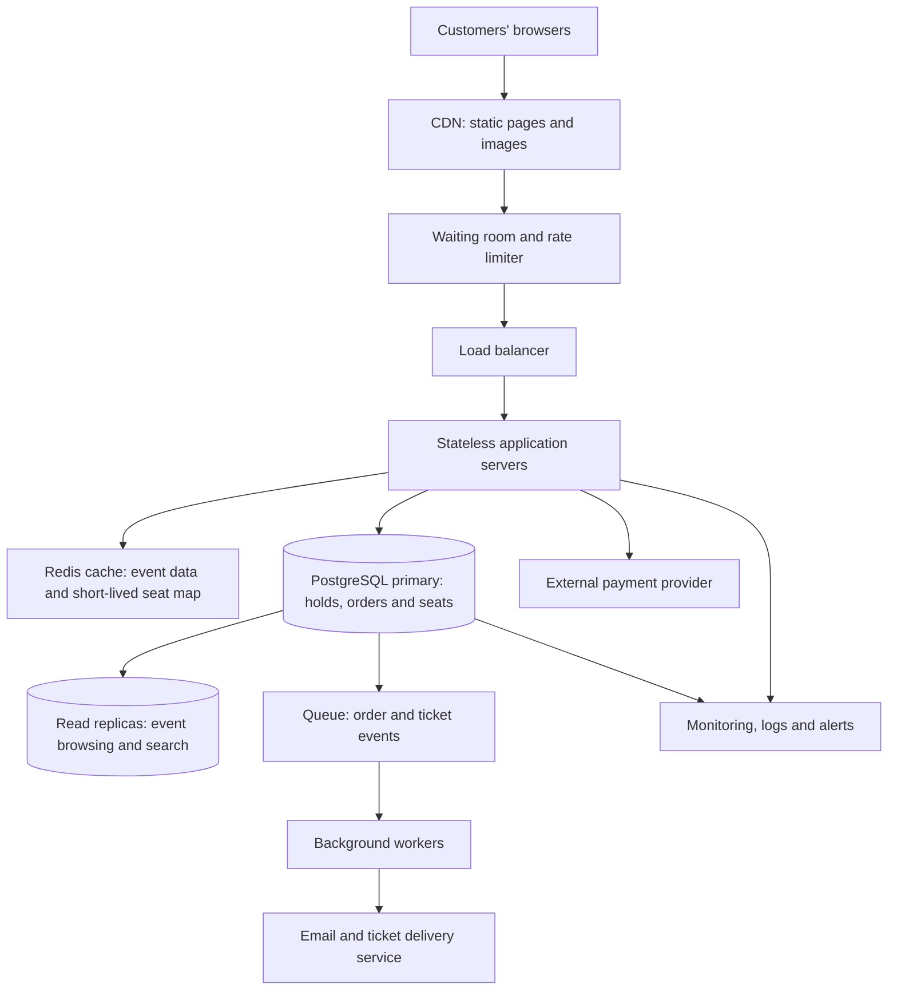

# TicketHub — Event Ticketing System Design

## 1. Requirements

### Functional requirements

- Users can browse and search events by name and city.
- Users can view event details and seat availability.
- Users can temporarily hold available seats for 10 minutes while completing payment.
- Users can pay for their held seats and receive tickets.
- Users can view their orders and tickets.
- The system releases expired holds so other customers can buy those seats.

### Non-functional requirements

- **No double-booking:** A seat must never be sold to more than one customer.
- **Scalability:** The system must handle a large burst of traffic during popular ticket sales.
- **Performance:** Event pages should load quickly during normal traffic.
- **Fairness:** A virtual waiting room should control access during major sales.
- **Reliability:** Failed payments and expired holds must not leave seats permanently unavailable.
- **Security:** Users must only access their own orders and tickets, and payment details must be handled securely.

Correctness is the highest priority for seat reservations and purchases.

## 2. Traffic and capacity estimates

### Normal daily traffic

The system has 50,000 daily visitors, with each visitor viewing approximately 10 pages.

- Page views per day = 50,000 × 10 = **500,000 page views**
- Average page views per second = 500,000 ÷ 86,400 ≈ **5.8 page views per second**

This is an average estimate. Actual traffic can be higher during busy periods.

The system also processes approximately 5,000 ticket sales per normal day. This is about 0.058 sales per second on average.

### Major ticket sale

During the sale, 200,000 people compete for 20,000 seats in 10 minutes.

- Sale duration = 10 × 60 = **600 seconds**
- Average arrival rate = 200,000 ÷ 600 ≈ **333 people per second**
- If each person makes about 10 requests, total requests = 200,000 × 10 = **2,000,000 requests**
- Average request rate during the sale = 2,000,000 ÷ 600 ≈ **3,333 requests per second**
- Buyer-to-seat ratio = 200,000 ÷ 20,000 = **10 buyers per seat**

The estimated request rate during the sale is hundreds of times higher than normal average page-view traffic. Actual peaks could be higher, so the system needs capacity testing and monitoring.

There are only 20,000 seats available. At most 20,000 individual seat purchases can succeed if every seat is sold, meaning at least 180,000 competing buyers will not obtain a seat.

The main challenge is handling this sudden traffic burst while guaranteeing that each seat can be held and sold only once.

## 3. API design

The API uses REST-style endpoints and JSON request and response bodies.

| Method and endpoint | Purpose | Successful response |
|---|---|---|
| `GET /events?search=&city=` | Browse and search events | `200 OK` |
| `GET /events/{id}` | View event details | `200 OK` |
| `GET /events/{id}/seats` | View seats and their displayed status | `200 OK` |
| `POST /holds` | Hold one or more seats for 10 minutes | `201 Created` |
| `POST /orders` | Complete a purchase for a valid hold | `201 Created` |
| `GET /me/tickets` | View the signed-in user's tickets | `200 OK` |

### Example: hold seats

**Request:**

```http
POST /holds
Idempotency-Key: unique-client-generated-key
Content-Type: application/json
```

```json
{
  "eventId": 7,
  "seatIds": [101, 102]
}
```

**Example successful response:**

```json
{
  "holdId": 55,
  "eventId": 7,
  "seatIds": [101, 102],
  "status": "held",
  "expiresAt": "2026-10-25T12:10:00Z"
}
```

If any requested seat is no longer available, the server returns `409 Conflict` and does not leave a partial hold behind.

### Example: place an order

**Request:**

```http
POST /orders
Idempotency-Key: unique-order-request-key
Content-Type: application/json
```

```json
{
  "holdId": 55,
  "paymentToken": "payment-provider-token"
}
```

The server verifies that the hold belongs to the signed-in user, has not expired, and is still valid before completing the purchase. Payment processing must be coordinated safely with the order status.

### Important API behaviour

- `200 OK`: A read request succeeded.
- `201 Created`: A hold or order was created successfully.
- `400 Bad Request`: The request contains invalid data.
- `401 Unauthorized`: The user must sign in.
- `403 Forbidden`: The user is not permitted to access the requested resource.
- `404 Not Found`: The event, seat, hold, or order does not exist.
- `409 Conflict`: The seat or hold conflicts with the current system state.
- `429 Too Many Requests`: The client has exceeded its allowed request rate.
- `500 Internal Server Error`: An unexpected server error occurred.

An idempotency key lets the server recognise retries of the same state-changing request, preventing a repeated request from creating duplicate holds or orders. The server stores the key and its result for an appropriate period.

Seat availability returned by a `GET` request is informational only. A seat may be taken immediately after the response. The server must verify availability again inside the database transaction when a customer requests a hold.

## 4. Data model

TicketHub uses a relational database such as PostgreSQL because seat reservations require reliable transactions, relationships, and uniqueness constraints.

### Table 1: `users`

| Column | Data type | Purpose |
|---|---|---|
| `id` | `BIGINT` | Primary key |
| `name` | `VARCHAR(100)` | User's name |
| `email` | `VARCHAR(255)` | User's email; must be unique |
| `password_hash` | `TEXT` | Secure password hash, never the plain-text password |
| `created_at` | `TIMESTAMP` | Account creation time |

### Table 2: `events`

| Column | Data type | Purpose |
|---|---|---|
| `id` | `BIGINT` | Primary key |
| `name` | `VARCHAR(200)` | Event name |
| `venue` | `VARCHAR(200)` | Event venue |
| `city` | `VARCHAR(100)` | Event city |
| `starts_at` | `TIMESTAMP` | Event start date and time |

One event can have many seats.

### Table 3: `seats`

| Column | Data type | Purpose |
|---|---|---|
| `id` | `BIGINT` | Primary key |
| `event_id` | `BIGINT` | Foreign key referencing `events.id` |
| `section` | `VARCHAR(50)` | Seating section |
| `row` | `VARCHAR(20)` | Row identifier |
| `number` | `VARCHAR(20)` | Seat number |
| `status` | `VARCHAR(20)` | `available`, `held`, or `sold` |
| `hold_id` | `BIGINT`, nullable | Identifier of the active hold, if any |
| `hold_expires_at` | `TIMESTAMP`, nullable | Expiration time for the hold, if any |

A unique constraint on `(event_id, section, row, number)` prevents duplicate records for the same physical seat at an event.

### Table 4: `orders`

| Column | Data type | Purpose |
|---|---|---|
| `id` | `BIGINT` | Primary key |
| `user_id` | `BIGINT` | Foreign key referencing `users.id` |
| `event_id` | `BIGINT` | Foreign key referencing `events.id` |
| `total` | `DECIMAL(10,2)` | Total purchase amount |
| `status` | `VARCHAR(20)` | For example, `pending`, `paid`, `failed`, or `cancelled` |
| `created_at` | `TIMESTAMP` | Order creation time |

### Table 5: `order_seats`

| Column | Data type | Purpose |
|---|---|---|
| `order_id` | `BIGINT` | Foreign key referencing `orders.id` |
| `seat_id` | `BIGINT` | Foreign key referencing `seats.id`; must be unique |

The combination of `order_id` and `seat_id` identifies the seats belonging to an order. A unique constraint on `seat_id` ensures a seat cannot be assigned to multiple orders.

### Relationships

- One user can have many orders: `users` → `orders` (one-to-many).
- One event can have many seats: `events` → `seats` (one-to-many).
- One event can have many orders: `events` → `orders` (one-to-many).
- One order can contain several seats, and a seat can belong to at most one order: `orders` → `order_seats` → `seats`.
- Foreign keys preserve valid relationships, while unique constraints protect against duplicate accounts, physical seats, and seat assignments.

## 5. Preventing double-booking

The database, not the browser or cache, is the final authority on whether a seat is available.

When a customer requests multiple seats, the application starts a database transaction and attempts to update only seats that are available or have expired holds.

### Illustrative PostgreSQL transaction

The following example demonstrates the database operation. The application must check how many rows were returned before deciding whether to commit or roll back.

```sql
BEGIN;

UPDATE seats
SET status = 'held',
    hold_id = 55,
    hold_expires_at = NOW() + INTERVAL '10 minutes'
WHERE id IN (101, 102)
  AND event_id = 7
  AND (
    status = 'available'
    OR (
      status = 'held'
      AND hold_expires_at < NOW()
    )
  )
RETURNING id;

-- Application checks the number of returned rows.
--
-- If exactly 2 rows are returned:
--     COMMIT;
--     Return 201 Created.
--
-- If fewer than 2 rows are returned:
--     ROLLBACK;
--     Return 409 Conflict.
--
-- COMMIT and ROLLBACK are alternative outcomes.
-- The application must execute only one of them.
```

The example uses hold ID `55` for illustration. In production, the server creates a valid hold record and associates it with the authenticated user. The application must ensure that the requested seat IDs are distinct and that every requested seat belongs to the specified event.

### Why this prevents double-booking

1. The database checks a seat's current status as part of the update.
2. When concurrent transactions attempt to update the same seat, PostgreSQL coordinates access to the affected rows.
3. After one transaction successfully changes a seat to `held`, a competing transaction cannot also successfully claim that same seat as available.
4. If even one requested seat cannot be held, the application rolls back the transaction so the customer does not retain only part of a multi-seat request.
5. The unique constraint on `order_seats.seat_id` provides an additional safeguard against assigning a seat to more than one order.

### Hold expiration

A background job can periodically identify expired holds and release them. The reservation transaction must also check expiry directly, so correctness does not depend on the background job running at the exact moment a hold expires.

A hold is only valid for the intended customer and event. A customer cannot purchase another customer's hold. The final order operation revalidates the hold before confirming the purchase.

### Payment safety

Payment processing involves an external service, so it cannot be made part of one ordinary PostgreSQL transaction. TicketHub should use an idempotent payment request and track order states such as `pending`, `paid`, and `failed`.

The application confirms an order only after receiving a verified payment result. It must handle retries and delayed payment notifications without issuing duplicate tickets. If payment fails or a hold expires, the system follows a defined cancellation and seat-release process. The order and ticket records must remain consistent.

## 6. System architecture

The following diagram shows how TicketHub components work together during normal traffic and major ticket sales.



### Component explanations

**CDN:** Serves static files, images, stylesheets, and other cacheable content near customers. This reduces repeated requests to the application servers.

**Waiting room and rate limiter:** Controls the number of customers entering the purchase flow during a major sale. A fair queue reduces sudden pressure on the application and database. The queue should avoid promising perfect arrival order unless the implementation can enforce it.

**Load balancer and stateless application servers:** Distributes incoming requests across multiple servers. Servers can scale horizontally because session and reservation state are stored in shared services rather than only in a single server's memory.

**Redis cache:** Speeds up event browsing and may serve a briefly cached seat map. Cached availability can become stale, so it must never be used as the final authority for a hold or purchase.

**PostgreSQL primary:** Stores authoritative seat, hold, and order state. Transactions, row-level locking, foreign keys, and unique constraints protect the correctness of purchases.

**Read replicas:** Handle suitable read-heavy operations, such as event browsing and search. Operations that decide whether a seat can be held or sold must use an authoritative, sufficiently current database path rather than trust a potentially stale replica.

**Queue and background workers:** Process tasks such as ticket generation and email delivery after purchase confirmation. This keeps non-critical work out of the immediate checkout response.

**Payment provider:** Processes payments securely. TicketHub records payment status and handles retries and callbacks idempotently.

**Monitoring and alerts:** Track request rates, response times, errors, database contention, queue depth, payment failures, and the number of successful or failed holds. These signals help operators respond to problems during the sale.

## 7. Architectural trade-offs

### 1. Correctness versus availability and speed

All seat holds and purchase decisions must follow the authoritative database rules. During heavy contention, some customers may need to retry or receive `409 Conflict`. This can be slower than relying on a cache, but it is preferable to selling the same seat twice.

### 2. Cache speed versus fresh availability data

Caching event details and seat maps reduces database traffic and makes browsing faster. However, a cached map can briefly show a seat as available after another customer has held it. TicketHub accepts this limitation because the final availability check occurs in the database. The API clearly communicates conflicts so customers can choose another seat.

### 3. Fairness versus system simplicity

A virtual waiting room introduces additional infrastructure and operational complexity. However, it can reduce overload and give customers a more orderly chance to enter the purchase flow instead of rewarding people who refresh most aggressively. Queue policies must be monitored and designed to resist abuse.

### 4. Synchronous checkout versus background processing

Waiting for every task, including ticket PDF generation and email delivery, would make checkout slower and more vulnerable to failures in secondary services. TicketHub confirms the order after payment verification, then uses a queue for ticket delivery. This improves responsiveness but requires reliable retries, monitoring, and protection against duplicate messages.

## Conclusion

TicketHub's central design principle is that **the database guarantees seat correctness, while the surrounding infrastructure absorbs and manages traffic**. The waiting room, CDN, cache, scalable application servers, read replicas, and background workers help the system handle a major sale. PostgreSQL transactions and constraints prevent two customers from successfully claiming the same seat, while idempotent payment and order handling help keep retries safe.
