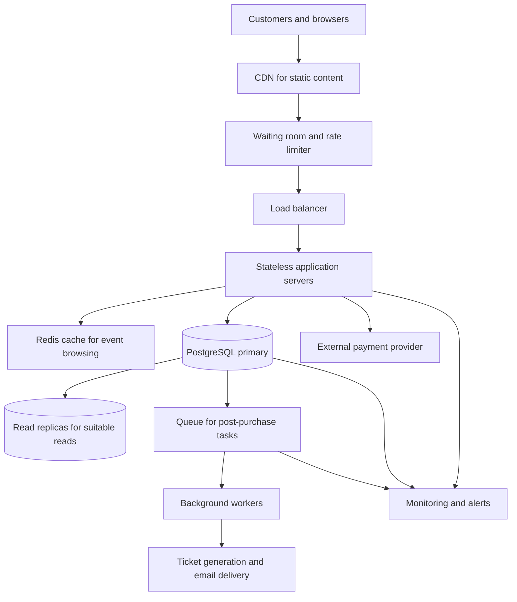

# TicketHub — Event Ticketing System Design

## 1. Context and Requirements

### Context

TicketHub is a website for selling tickets to concerts and other events. It has 2 million registered users. On a normal day, 50,000 people visit the website, each viewing approximately 10 pages, and the system sells 5,000 tickets. During a popular concert sale, 200,000 people compete for 20,000 seats in the first 10 minutes.

The design must support normal browsing and sudden traffic spikes without selling the same seat to two customers.

### Functional requirements

- Users can browse and search for events.
- Users can view event details and seat availability.
- Signed-in users can hold available seats for 10 minutes.
- Users can pay for seats they have successfully held.
- Users can view their orders and tickets.
- Expired holds can be released so other customers can reserve those seats.

### Non-functional requirements

- **Correctness:** A seat must never be sold to more than one customer.
- **Performance:** Event pages and search results should load quickly.
- **Scalability:** The system must handle thousands of requests per second during a major sale.
- **Fairness:** A waiting room should control access during popular sales.
- **Reliability:** Payment retries and temporary failures must not create duplicate orders or tickets.
- **Security:** Users must only access their own holds, orders, and tickets.

### Goals and non-goals

The main goals are reliable seat allocation, responsive event browsing, safe payment processing, and handling sudden traffic spikes.

The initial design does not attempt to support multiple countries, multiple currencies, or a multi-region database. These can be considered as future improvements.

## 2. Traffic and Capacity Estimates

### Normal traffic

The system receives 50,000 visitors per day, and each visitor views approximately 10 pages.

Page views per day:

50,000 × 10 = **500,000 page views per day**

Average page views per second:

500,000 ÷ 86,400 ≈ **5.8 requests per second**

The system sells approximately 5,000 tickets per normal day:

5,000 ÷ 86,400 ≈ **0.058 ticket sales per second**

These are averages, not peak values. Actual demand can vary throughout the day.

### Traffic during a major sale

During a popular concert sale, 200,000 people compete for 20,000 seats over 10 minutes.

Sale duration:

10 × 60 = **600 seconds**

Average arriving customers per second:

200,000 ÷ 600 ≈ **333 customers per second**

Assuming each customer makes approximately 10 requests:

200,000 × 10 = **2,000,000 requests**

Average request rate during the sale:

2,000,000 ÷ 600 ≈ **3,333 requests per second**

Buyer-to-seat ratio:

200,000 ÷ 20,000 = **10 buyers per seat**

If all seats sell, at most 20,000 buyers can obtain a seat. At least 180,000 competing buyers will not obtain one.

The estimated sale traffic is approximately 575 times the normal average page-view rate of 5.8 requests per second. The system therefore needs load testing, traffic control, caching, scalable application servers, and a protected primary database.

## 3. API Design

TicketHub uses REST-style endpoints and JSON request and response bodies.

| Method and endpoint | Purpose | Expected success status |
|---|---|---|
| `GET /events?search=&city=` | Browse and search events | `200 OK` |
| `GET /events/{id}` | View event details | `200 OK` |
| `GET /events/{id}/seats` | View the event's seat map and displayed availability | `200 OK` |
| `POST /holds` | Temporarily hold available seats | `201 Created` |
| `POST /orders` | Create an order and begin or complete checkout for a valid hold | `201 Created` |
| `GET /me/tickets` | View tickets belonging to the signed-in user | `200 OK` |

### Example: hold seats

Request:

```http
POST /holds
Content-Type: application/json
Idempotency-Key: hold-request-abc123
```

```json
{
  "eventId": 7,
  "seatIds": [101, 102]
}
```

Example successful response:

```json
{
  "holdId": 55,
  "eventId": 7,
  "seatIds": [101, 102],
  "status": "active",
  "expiresAt": "2026-10-25T12:10:00Z"
}
```

The expiry time is an illustrative example. The server calculates the actual expiry time when creating the hold.

If one or more requested seats are no longer available, the server returns `409 Conflict` and rolls back the entire reservation attempt. It must not leave a partial hold behind.

### Example: create an order

Request:

```http
POST /orders
Content-Type: application/json
Idempotency-Key: order-request-xyz789
```

```json
{
  "holdId": 55,
  "paymentToken": "payment-provider-token"
}
```

The server checks that the hold belongs to the signed-in user, has not expired, and contains the requested seats. The payment provider processes the payment securely. The server must verify the payment result before marking the order as paid and issuing tickets.

### API status codes and error handling

- `200 OK`: A read request succeeded.
- `201 Created`: A hold or order resource was created.
- `400 Bad Request`: The request data is invalid.
- `401 Unauthorized`: The user must sign in.
- `403 Forbidden`: The user is not permitted to access the resource.
- `404 Not Found`: The requested event, hold, order, or ticket does not exist.
- `409 Conflict`: A seat is unavailable, a hold has expired, or the requested action conflicts with current state.
- `429 Too Many Requests`: The client has exceeded its request limit.
- `500 Internal Server Error`: An unexpected server error occurred.

### Idempotency and availability

The client sends an idempotency key with state-changing requests. The server stores the key and the result so that retrying the same request does not create duplicate holds or orders. Reusing a key with different request data must be rejected.

Seat availability returned by a `GET` endpoint is informational. Another customer may reserve a seat immediately after the response. The database must check availability again when processing the hold request.

## 4. Data Model

TicketHub uses PostgreSQL, a relational database that supports transactions, foreign keys, unique constraints, and row-level locking.

### Table 1: `users`

| Column | Type | Purpose |
|---|---|---|
| `id` | `BIGINT PRIMARY KEY` | Unique user identifier |
| `name` | `VARCHAR(100) NOT NULL` | User's name |
| `email` | `VARCHAR(255) UNIQUE NOT NULL` | Unique email address |
| `password_hash` | `TEXT NOT NULL` | Secure password hash |
| `created_at` | `TIMESTAMPTZ NOT NULL` | Account creation time |

Passwords are stored as secure hashes, never as plain text.

### Table 2: `events`

| Column | Type | Purpose |
|---|---|---|
| `id` | `BIGINT PRIMARY KEY` | Unique event identifier |
| `name` | `VARCHAR(200) NOT NULL` | Event name |
| `venue` | `VARCHAR(200) NOT NULL` | Event venue |
| `city` | `VARCHAR(100) NOT NULL` | Event city |
| `starts_at` | `TIMESTAMPTZ NOT NULL` | Event start time |

One event can have many seats and many orders.

### Table 3: `seats`

| Column | Type | Purpose |
|---|---|---|
| `id` | `BIGINT PRIMARY KEY` | Unique seat record |
| `event_id` | `BIGINT NOT NULL REFERENCES events(id)` | Event to which the seat belongs |
| `section` | `VARCHAR(50) NOT NULL` | Seating section |
| `row_label` | `VARCHAR(20) NOT NULL` | Seat row |
| `seat_number` | `VARCHAR(20) NOT NULL` | Seat number |
| `status` | `VARCHAR(20) NOT NULL` | `available`, `held`, or `sold` |
| `hold_id` | `BIGINT NULL REFERENCES holds(id)` | Active hold, if any |

A unique constraint on `(event_id, section, row_label, seat_number)` prevents duplicate records for the same physical seat at an event.

The `status` field must accept only the defined values. A database check constraint can enforce this rule.

### Table 4: `holds`

| Column | Type | Purpose |
|---|---|---|
| `id` | `BIGINT PRIMARY KEY` | Unique hold identifier |
| `user_id` | `BIGINT NOT NULL REFERENCES users(id)` | Customer who owns the hold |
| `event_id` | `BIGINT NOT NULL REFERENCES events(id)` | Event being reserved |
| `status` | `VARCHAR(20) NOT NULL` | `active`, `expired`, or `converted` |
| `expires_at` | `TIMESTAMPTZ NOT NULL` | Time at which the hold expires |
| `idempotency_key` | `VARCHAR(100) UNIQUE NOT NULL` | Prevents duplicate hold creation |
| `created_at` | `TIMESTAMPTZ NOT NULL` | Hold creation time |

A hold can cover several seats for the same event. The hold belongs to one user, and the server checks ownership before allowing checkout.

### Table 5: `orders`

| Column | Type | Purpose |
|---|---|---|
| `id` | `BIGINT PRIMARY KEY` | Unique order identifier |
| `user_id` | `BIGINT NOT NULL REFERENCES users(id)` | Customer placing the order |
| `hold_id` | `BIGINT NOT NULL UNIQUE REFERENCES holds(id)` | Hold converted into the order |
| `total_amount` | `NUMERIC(10,2) NOT NULL` | Total amount payable |
| `status` | `VARCHAR(20) NOT NULL` | `pending`, `paid`, `failed`, or `cancelled` |
| `payment_reference` | `VARCHAR(150) UNIQUE` | Payment provider reference, when available |
| `created_at` | `TIMESTAMPTZ NOT NULL` | Order creation time |

A unique constraint on `hold_id` prevents the same hold from creating multiple orders.

### Table 6: `order_seats`

| Column | Type | Purpose |
|---|---|---|
| `order_id` | `BIGINT NOT NULL REFERENCES orders(id)` | Order containing the seat |
| `seat_id` | `BIGINT NOT NULL UNIQUE REFERENCES seats(id)` | Seat assigned to the order |

The primary key is `(order_id, seat_id)`. The additional unique constraint on `seat_id` prevents a seat from being assigned to more than one order.

### Table relationships

- One user can create many holds: `users` → `holds`.
- One event has many seats: `events` → `seats`.
- One event can have many holds: `events` → `holds`.
- One hold can reserve several seats: `holds` → `seats`.
- One user can create many orders: `users` → `orders`.
- One hold can produce at most one order: `holds` → `orders`.
- An order can contain several seats through `order_seats`.
- Each seat can appear in at most one order because `order_seats.seat_id` is unique.

Foreign keys protect relationships, while unique constraints protect against duplicate users, physical seats, holds, and seat assignments.

## 5. Preventing Double-Booking

The database is the final authority on seat availability. A cache, browser, or waiting room cannot guarantee that a seat is still available.

TicketHub uses an atomic conditional update inside a database transaction. This checks the seat status and changes it only if the seat is available or its previous hold has expired.

### Illustrative PostgreSQL transaction

The following is illustrative transaction logic. The application creates the hold record and runs the seat update in the same transaction.

```sql
BEGIN;

-- Create the hold record in this transaction.
INSERT INTO holds (
    id,
    user_id,
    event_id,
    status,
    expires_at,
    idempotency_key,
    created_at
)
VALUES (
    55,
    9001,
    7,
    'active',
    NOW() + INTERVAL '10 minutes',
    'hold-request-abc123',
    NOW()
);

-- Claim the requested seats only if they are available
-- or their previous hold has expired.
UPDATE seats AS s
SET status = 'held',
    hold_id = 55
WHERE s.event_id = 7
  AND s.id IN (101, 102)
  AND (
      s.status = 'available'
      OR (
          s.status = 'held'
          AND EXISTS (
              SELECT 1
              FROM holds AS old_hold
              WHERE old_hold.id = s.hold_id
                AND old_hold.expires_at <= NOW()
          )
      )
  )
RETURNING s.id;

-- Application logic checks the number of returned rows.
-- If exactly 2 rows are returned, COMMIT the transaction.
-- If fewer than 2 rows are returned, ROLLBACK the transaction.
--
-- COMMIT and ROLLBACK are alternative outcomes.
-- Execute only the appropriate one, never both.
```

The example uses illustrative IDs. In production, IDs are generated by the application or database, and the server uses the authenticated user's identity rather than trusting a user ID supplied by the client.

### Why this prevents two customers from claiming the same seat

1. The conditional update only changes seats whose current state permits a new hold.
2. PostgreSQL locks rows being updated and coordinates competing transactions. If two customers attempt to hold the same seat, one transaction must wait and then re-evaluate whether the seat is still eligible.
3. The application checks the number of rows returned. If a request for two seats updates only one, the entire transaction is rolled back.
4. The database's unique constraint on `order_seats.seat_id` provides a final safeguard against assigning one seat to two orders.
5. An order can reference a hold only once because `orders.hold_id` is unique.

### Expired holds

A background worker periodically finds expired holds and releases their seats. The reservation transaction also checks expiry directly, so correctness does not depend on the worker running at an exact time.

When a hold expires, the system updates the hold status and makes its seats available again safely. These operations must be coordinated with database transactions so an expired hold cannot be purchased while another customer is taking its seats.

### Payment and retries

Payment is processed by an external provider, so it cannot be included in one ordinary PostgreSQL transaction. TicketHub records the order as `pending`, sends an idempotent payment request, and confirms the order only after verifying successful payment.

The system handles retries and delayed payment notifications without creating duplicate orders or tickets. If payment fails, it marks the order appropriately and follows the seat-release policy. While payment is being processed, the system must preserve the reservation safely or reject checkout if the hold is no longer valid.

## 6. High-Level Architecture



### Component explanations

**CDN:** Serves static files, images, stylesheets, and other cacheable content close to customers. This reduces repeated requests to the application servers.

**Waiting room and rate limiter:** Controls how many customers enter the purchase flow during a popular sale. It helps prevent a sudden surge from overwhelming the application and database. Queue policies should be fair and monitored.

**Load balancer:** Distributes incoming requests across multiple application servers and avoids relying on a single application server.

**Stateless application servers:** Handle event browsing, seat holds, checkout, and ticket requests. They can scale horizontally by adding more servers. Shared reservation state is stored in the database rather than only in one server's memory.

**Redis cache:** Stores frequently requested event details and other suitable read data to reduce database load. Cached seat availability may become stale, so Redis must never be the final authority for reserving or selling a seat.

**PostgreSQL primary:** Stores authoritative users, events, seats, holds, and orders. Transactions, conditional updates, row-level locking, foreign keys, and unique constraints protect the correctness of reservations.

**Read replicas:** Handle suitable read-heavy operations such as event browsing. Seat allocation and checkout decisions use the authoritative database path rather than relying on potentially stale replica data.

**Queue and background workers:** Process tasks such as ticket generation and email delivery after purchase confirmation. This prevents slower secondary tasks from unnecessarily delaying the checkout response.

**Payment provider:** Processes payments securely. TicketHub records verified payment results and handles retries idempotently.

**Monitoring and alerts:** Track request rates, response times, error rates, database contention, queue depth, and payment failures. These measurements help operators detect bottlenecks and respond during a major sale.

### How the architecture handles the sale

The CDN and Redis reduce unnecessary database requests. The waiting room and rate limiter control the rate at which customers enter checkout. The load balancer distributes requests across scalable application servers. Read replicas serve suitable browsing traffic, while the primary database protects seat allocation using transactions and constraints. Background workers handle ticket delivery after payment confirmation.

## 7. Trade-Offs, Alternatives, and Risks

### Trade-off 1: Correctness versus speed

Checking every reservation against the authoritative database can increase latency when many customers compete for the same seat. However, relying on a cache alone could allow double-booking. TicketHub prioritises correctness and accepts that some customers may receive `409 Conflict` and need to select another seat.

### Trade-off 2: Caching versus fresh availability

Caching event pages and seat maps reduces database traffic and improves browsing speed. However, cached availability can be stale. TicketHub accepts this for browsing because every hold and purchase is checked again against the database.

### Trade-off 3: Waiting-room fairness versus simplicity

A waiting room introduces extra infrastructure and operational complexity. However, it helps control traffic and reduces the advantage of repeatedly refreshing the page. Queue behaviour must be monitored and protected against abuse.

### Trade-off 4: Immediate ticket delivery versus background processing

Generating and emailing tickets synchronously can slow checkout and make the purchase depend on email service availability. A background queue makes checkout more responsive, but requires retries, monitoring, and protection against duplicate ticket messages.

### Alternatives considered

A single application server and database would be simpler to build, but would be less resilient and could struggle during a major sale. Using only cached seat availability would reduce database reads but would not reliably prevent two customers from claiming the same seat. TicketHub instead uses scalable application servers for traffic handling and PostgreSQL transactions for seat correctness.

### Risks and open questions

- The system needs load testing to determine the actual capacity of the database and application servers.
- The waiting-room policy must be designed to be fair and resistant to automated abuse.
- Payment timeouts and delayed callbacks require careful reconciliation.
- The team must decide the precise policy for holds during an ongoing payment attempt.
- Monitoring and recovery procedures must be tested before a major concert sale.

## Conclusion

TicketHub is designed to support 2 million registered users and a major sale in which 200,000 people compete for 20,000 seats. Traffic estimates justify the waiting room, cache, scalable application servers, read replicas, and background workers. Most importantly, an atomic conditional update inside a database transaction, backed by unique constraints, prevents competing customers from successfully claiming the same seat. Idempotent payment and order handling help the system recover safely from retries and failures.