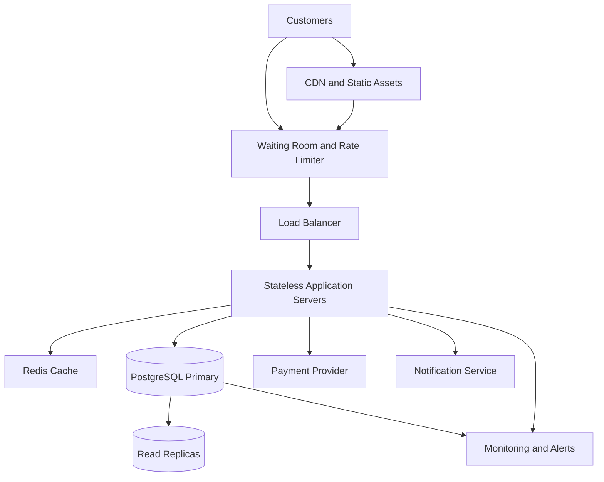

# TicketHub — Event Ticketing System Design

## 1. Context and Requirements

### Context

TicketHub is a website for selling tickets to concerts and other events. It has 2 million registered users and must support normal daily activity as well as sudden traffic spikes when popular concerts go on sale.

The most important requirements are fast browsing, fair access to tickets, reliable payments, and preventing two customers from purchasing the same seat.

### Goals

- Allow users to browse events and view available seats.
- Allow users to temporarily hold available seats.
- Allow users to purchase tickets securely.
- Allow users to view their orders and purchased tickets.
- Prevent double-booking, even during a popular concert sale.
- Remain responsive during sudden increases in traffic.

### Non-goals

- Building a social network for event attendees.
- Supporting ticket resale between customers.
- Implementing a recommendation engine.
- Building a payment processing service from scratch.

### Functional Requirements

1. Users can register and access their accounts.
2. Users can browse events and view event details.
3. Users can view seat availability and prices.
4. Users can hold available seats temporarily.
5. Users can pay for an order and receive confirmed tickets.
6. Users can view their orders and tickets.
7. Expired holds release seats so other customers can purchase them.

### Non-functional Requirements

- **Performance:** Event listings and seat maps should load quickly under normal traffic.
- **Correctness:** A seat must never be sold to two customers.
- **Fairness:** A waiting room should control access during high-demand sales and direct customers through an orderly queue.
- **Availability:** The website should remain usable if an application server fails.
- **Security:** Users must only access their own orders and tickets, and payment details must be handled securely.
- **Reliability:** Repeated payment requests must not create duplicate orders or charges.
- **Consistency:** Seat reservations and purchases must be coordinated through database transactions.

## 2. Traffic Estimates

The assignment gives the following figures:

- 2 million registered users.
- 50,000 visitors on a normal day.
- Each visitor views 10 pages.
- 5,000 tickets sold on a normal day.
- During a popular concert sale, 200,000 people attempt to buy 20,000 seats within 10 minutes.

### Normal Traffic

**Daily page views**

50,000 visitors × 10 pages = 500,000 page views per day.

**Average page views per second**

500,000 ÷ 86,400 seconds ≈ 5.8 page views per second.

**Average ticket sales per second**

5,000 ÷ 86,400 seconds ≈ 0.058 ticket sales per second.

These are daily averages, not peak traffic figures. Actual traffic may be much higher around popular events.

### Popular Concert Sale

**Average purchase attempts per second**

200,000 ÷ 600 seconds ≈ 333 purchase attempts per second.

**Seats available per second**

20,000 ÷ 600 seconds ≈ 33.3 seats per second, averaged across the sale window.

**Demand compared with supply**

200,000 people ÷ 20,000 seats = 10 people per seat.

There are ten potential buyers for every available seat. Not every purchase attempt will result in a successful sale.

### Comparison

The popular sale creates approximately 333 purchase attempts per second, compared with about 0.058 ticket sales per second during a normal day. These figures measure different activities, so they should not be treated as identical request types. Nevertheless, they show why the system needs a special strategy for high-demand sales.

The system must handle this burst without allowing overselling or unfairly allocating seats.

## 3. API Design

TicketHub uses a REST API. Requests and responses use JSON unless the endpoint returns another format.

### Endpoint 1: Browse Events

**Request**

`GET /api/events`

Returns a list of upcoming events.

**Example response — 200 OK**

```json
{
  "events": [
    {
      "id": 101,
      "name": "Summer Music Festival",
      "date": "2027-06-20",
      "venue": "City Arena"
    }
  ]
}
```

### Endpoint 2: View Event Seats

**Request**

`GET /api/events/101/seats`

Returns the seats for an event and their current availability.

**Example response — 200 OK**

```json
{
  "eventId": 101,
  "seats": [
    {
      "id": 501,
      "label": "A1",
      "status": "available",
      "price": 2500
    },
    {
      "id": 502,
      "label": "A2",
      "status": "sold",
      "price": 2500
    }
  ]
}
```

Seat availability shown to a customer is informational. The database must check availability again when the customer attempts to hold a seat.

### Endpoint 3: Hold Seats

**Request**

`POST /api/orders/hold`

Creates a temporary hold on one or more available seats.

**Example request**

```json
{
  "eventId": 101,
  "seatIds": [501],
  "idempotencyKey": "hold-request-abc123"
}
```

**Example response — 201 Created**

```json
{
  "orderId": 9001,
  "status": "held",
  "expiresAt": "2027-06-20T10:15:00Z"
}
```

If a requested seat is already held or sold, the API returns `409 Conflict`. The database transaction ensures that competing requests cannot both reserve the same seat.

### Endpoint 4: Pay for an Order

**Request**

`POST /api/orders/9001/payment`

Initiates payment for a valid order using a trusted payment provider.

**Example request**

```json
{
  "paymentMethodToken": "provider-issued-token",
  "idempotencyKey": "payment-request-xyz789"
}
```

**Possible responses**

- `200 OK` — payment is confirmed and the order is paid.
- `202 Accepted` — payment is still being processed.
- `409 Conflict` — the order or seat hold is no longer valid.
- `402 Payment Required` — payment was declined, if this status is used by the API's documented payment contract.

The server must verify payment-provider results before confirming tickets. It must not trust a success message supplied only by the browser.

### Endpoint 5: View My Orders

**Request**

`GET /api/me/orders`

Returns the authenticated user's orders.

**Example response — 200 OK**

```json
{
  "orders": [
    {
      "id": 9001,
      "eventId": 101,
      "status": "paid",
      "totalAmount": 2500
    }
  ]
}
```

### Endpoint 6: View Tickets for an Order

**Request**

`GET /api/orders/9001/tickets`

Returns tickets belonging to the authenticated user for the specified order.

**Example response — 200 OK**

```json
{
  "orderId": 9001,
  "tickets": [
    {
      "ticketId": 7001,
      "eventId": 101,
      "seatLabel": "A1",
      "status": "confirmed"
    }
  ]
}
```

The API checks ownership before returning order or ticket information. It returns `401 Unauthorized` for an unauthenticated request and `404 Not Found` when the requested resource does not exist or is not accessible to the user.

## 4. Data Model

TicketHub uses a relational database such as PostgreSQL because ticket sales require transactions, constraints, and consistent relationships.

The main tables are `users`, `events`, `seats`, and `orders`. A fifth table, `tickets`, records confirmed tickets.

### Table 1: users

Stores customer accounts.

| Column | Type | Purpose |
|---|---|---|
| id | BIGINT PRIMARY KEY | Unique user ID |
| name | VARCHAR(100) | Customer name |
| email | VARCHAR(255) UNIQUE | Unique login email |
| created_at | TIMESTAMP | Account creation time |

### Table 2: events

Stores concerts and other events.

| Column | Type | Purpose |
|---|---|---|
| id | BIGINT PRIMARY KEY | Unique event ID |
| name | VARCHAR(200) | Event name |
| venue | VARCHAR(200) | Event location |
| starts_at | TIMESTAMP | Event start time |
| status | VARCHAR(20) | Event sales status |

### Table 3: seats

Stores seats belonging to events.

| Column | Type | Purpose |
|---|---|---|
| id | BIGINT PRIMARY KEY | Unique seat record |
| event_id | BIGINT FOREIGN KEY | References events.id |
| seat_label | VARCHAR(20) | Seat label, such as A1 |
| price | DECIMAL(10,2) | Ticket price |
| status | VARCHAR(20) | available, held, or sold |
| held_by_order_id | BIGINT NULL | Order holding the seat |
| hold_expires_at | TIMESTAMP NULL | Hold expiration time |

A unique constraint on `(event_id, seat_label)` prevents duplicate seat records for the same event.

### Table 4: orders

Stores purchase attempts and order status.

| Column | Type | Purpose |
|---|---|---|
| id | BIGINT PRIMARY KEY | Unique order ID |
| user_id | BIGINT FOREIGN KEY | References users.id |
| status | VARCHAR(20) | held, pending_payment, paid, expired, or cancelled |
| total_amount | DECIMAL(10,2) | Total order price |
| idempotency_key | VARCHAR(100) UNIQUE | Prevents duplicate request processing |
| expires_at | TIMESTAMP NULL | Expiration of a temporary hold |
| created_at | TIMESTAMP | Order creation time |

### Table 5: tickets

Stores confirmed tickets.

| Column | Type | Purpose |
|---|---|---|
| id | BIGINT PRIMARY KEY | Unique ticket ID |
| order_id | BIGINT FOREIGN KEY | References orders.id |
| seat_id | BIGINT UNIQUE FOREIGN KEY | References seats.id |
| issued_at | TIMESTAMP | Ticket issue time |

The unique constraint on `seat_id` ensures that a seat cannot be associated with multiple confirmed ticket records.

### Relationships

- One user can have many orders.
- One event can have many seats.
- One order can contain multiple tickets.
- Each ticket belongs to one order and one seat.
- Each seat belongs to one event.
- A seat's status and hold information determine whether it can be reserved.

Foreign keys preserve relationships, while unique constraints prevent duplicate records.

## 5. Architecture

### High-Level Architecture Diagram



### Component Explanations

**1. CDN and Static Assets**

A content delivery network serves static resources such as images, stylesheets, and JavaScript from locations close to customers. This reduces the work done by application servers.

**2. Waiting Room and Rate Limiter**

During a popular sale, a virtual waiting room queues or limits incoming customers before they reach the ticket-purchasing service. Rate limiting prevents a small number of clients from overwhelming the system.

The waiting room must be designed to provide an orderly admission process. It does not reserve seats or guarantee that every customer receives a ticket.

**3. Load Balancer**

The load balancer distributes incoming requests across healthy application servers. If one server fails, traffic can be directed to other healthy servers.

**4. Stateless Application Servers**

Application servers handle authentication, event browsing, seat holds, orders, and payment coordination. They do not depend on local memory to retain essential customer or order state. This makes it easier to add or replace servers.

**5. Redis Cache**

Redis stores frequently accessed, non-authoritative information such as event details and cached seat-map views. It reduces repeated database reads.

Redis is not the final authority for seat availability. A cached seat map may be out of date, so the database must verify and reserve seats transactionally.

**6. PostgreSQL Primary Database**

The primary database stores authoritative event, seat, order, and ticket information. Transactions and constraints protect seat allocation and prevent two successful purchases of the same seat.

**7. Read Replicas**

Read replicas can serve suitable read-only requests, such as some event listings and historical order views. They reduce read pressure on the primary database.

Seat availability checks that determine whether a purchase can succeed must use an authoritative, consistent operation rather than relying on potentially stale replica data.

**8. Payment Provider**

An external payment provider processes payments. TicketHub verifies payment results and coordinates the transition from a held order to a paid order. Idempotency keys and payment reconciliation help handle retries and delayed responses.

**9. Notification Service**

The notification service sends order confirmations and ticket information after a purchase is confirmed. Notifications can be processed asynchronously so that sending an email does not block the purchase request.

**10. Monitoring and Alerts**

Monitoring tracks response times, error rates, queue length, database load, failed payments, and seat-hold conflicts. Alerts help the team identify problems during a major sale.

### How the System Prevents Double-Booking

A cached seat map or waiting room cannot guarantee that a seat is sold only once. The database must enforce this rule.

When two customers attempt to hold the same seat, the application performs an atomic conditional update inside a database transaction. Conceptually, it updates a seat only when its status is `available`, or when an existing hold has safely expired.

For example:

```sql
UPDATE seats
SET status = 'held',
    held_by_order_id = 9001,
    hold_expires_at = CURRENT_TIMESTAMP + INTERVAL '10 minutes'
WHERE id = 501
  AND status = 'available'
RETURNING id;
```

The application checks how many rows were returned:

- If one row is returned, the seat was successfully held.
- If no row is returned, the seat was unavailable and the request must not claim success.

For a multi-seat order, the application performs the required updates in one transaction and rolls back if all requested seats cannot be held.

The database transaction and appropriate constraints protect the operation from concurrent requests. Before issuing a ticket, the system also verifies the order and payment state and ensures that the seat has not already been sold.

When a hold expires, the system releases it safely so that another customer can attempt to reserve the seat. The expiry process must not release a seat that has already been paid for.

## 6. Trade-offs

### Trade-off 1: Strong Consistency vs. Higher Throughput

Checking and reserving seats through the primary database provides reliable allocation and prevents double-booking. However, the primary database can become a bottleneck during a major sale.

**Decision:** Use transactional seat allocation on the primary database, while caching non-critical read data and scaling the application layer horizontally. Correctness takes priority over allowing two conflicting purchases to proceed.

### Trade-off 2: Waiting Room vs. Immediate Access

A waiting room can reduce the load reaching the purchasing service and make admission more orderly. However, customers may have to wait, and a queue does not guarantee that they will get a ticket.

**Decision:** Use a waiting room for unusually popular events and clearly communicate queue status to customers. Normal event browsing should remain accessible without unnecessary waiting.

### Trade-off 3: Short Seat Holds vs. Customer Convenience

Short holds allow abandoned reservations to release seats quickly. However, customers may lose their reservations if payment takes too long.

**Decision:** Use a defined hold period, display the expiry time, and release expired holds safely. The hold duration should be adjusted using observed payment times and user experience.

### Trade-off 4: Cache Speed vs. Freshness

Caching event information and seat maps reduces database load, but cached availability can become stale during a sale.

**Decision:** Cache event descriptions and other suitable read data, but always validate seat availability against the authoritative database before confirming a hold or purchase.

## 7. Risks and Open Questions

- **Payment delays:** A payment provider may respond slowly or return an uncertain result. The system needs idempotent payment processing and reconciliation before issuing tickets.
- **Database overload:** A very popular event can overload the primary database. Admission control, efficient queries, monitoring, and load testing are necessary.
- **Expired holds:** A delayed cleanup task could leave seats unavailable longer than intended. Expiry must also be checked during the reservation operation.
- **Fairness:** The waiting-room policy must be transparent and consistent. The team should decide how customers are admitted and how reconnecting users are handled.
- **Regional resilience:** The design needs a tested recovery plan for a database or regional failure.
- **Payment and seat coordination:** The team must define how a seat hold is finalized, released, or reconciled when payment succeeds but the application does not receive the response.

## 8. Conclusion

TicketHub must support ordinary event browsing while protecting the correctness of ticket sales during sudden traffic spikes. Traffic estimates show that a popular sale can bring hundreds of purchase attempts per second, with ten potential buyers for every available seat.

The proposed architecture uses a CDN, waiting room, load balancer, stateless application servers, caching, a relational database, and monitoring to manage this demand. The most important design decision is that seat allocation remains authoritative in the database. Atomic conditional updates, transactions, unique constraints, expiring holds, and idempotent payment handling work together to prevent double-booking and make the purchasing process reliable.
